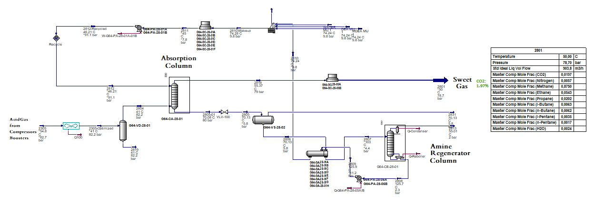
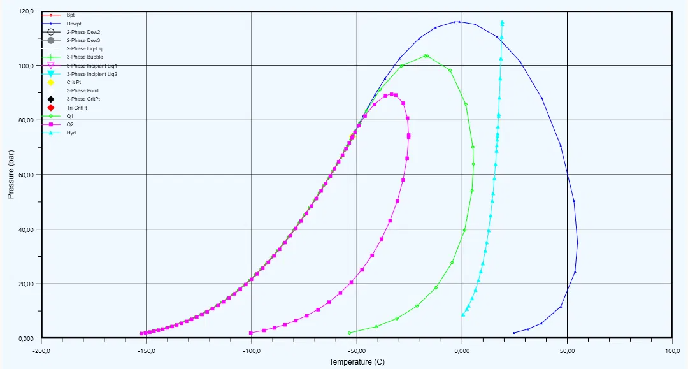

[English](README.md) | [Deutsch](README.de.md) | [Français](README.fr.md)

# Simulation und Optimierung der aminbasierten CO₂-Abtrennungsanlage (AGRU, Einheit 28) in einer Erdgasaufbereitungsanlage mit Aspen HYSYS® (Rhourde-Nouss, Südosten Algeriens)

## Übersicht
Anhand des anlagenspezifischen Datenblatts wurde ein vollständiges HYSYS®-basiertes numerisches Modell der CO₂-Abtrennungsanlage (AGRU) von Rhourde-Nouss (Südosten Algeriens) entwickelt, die Teil einer zentralen Aufbereitungsanlage (Central Processing Facility) für die Erdgasbehandlung ist.

## Zielsetzung
Einhaltung der Verkaufsgas-Spezifikation von 2 Mol-% CO₂ in der zentralen Aufbereitungsanlage Rhourde Nouss (Südosten Algeriens) durch Optimierung der Temperaturen der armen Aminlösung und des Rohgases in der aminbasierten CO₂-Abtrennungsanlage (AGRU).

## Fließschema

  
   
  <em>Abbildung 1: Gelöstes und optimiertes Fließschema der CO₂-Abtrennungsanlage in Rhourde-Nouss.</em>

## Vorgehensweise
- Ein vollständiges aminbasiertes AGRU-Fließschema in Aspen HYSYS® aufgebaut und zur Konvergenz gebracht.
- Die CO₂-Bodenwirkungsgrade so kalibriert, dass der Absorber der Leistung industrieller Sauergasabsorber mit DEA/MDEA-Mischungen entspricht.
- Den Einfluss von vier Betriebsvariablen untersucht: Temperatur der armen Aminlösung, Einspeisegastemperatur, Aminumlaufmenge und Regeneratorleistung.

## Sicherheitsprüfungen
- Phasenhüllkurve und Hydratanalyse verwendet, um sichere Temperaturgrenzen für die arme Aminlösung und das Einspeisegas festzulegen.
- Kondensations- und Hydratabstände für die gewählten Betriebsbedingungen geprüft.

  
   
  <em>Abbildung 2: Phasenhüllkurve und Hydratanalyse für Strom 2305 (aus der Booster-Kompressoreinheit).</em>

## Zentrales Ergebnis
| Parameter | Basisfall | Optimiert | Spezifikation |
|---|---|---|---|
| CO₂ im Süßgas | 3,7 Mol-% | 1,97 Mol-% | < 2 Mol-% |

## Hinweise
Die Eingangsdaten wurden bereinigt; es sind keine vertraulichen Anlagen- oder Herstellerdaten enthalten.

*Dieses Repository ist lediglich eine Vorschau einiger mit HYSYS® erzielter Ergebnisse (es ist keine Simulationsdatei angehängt).*
