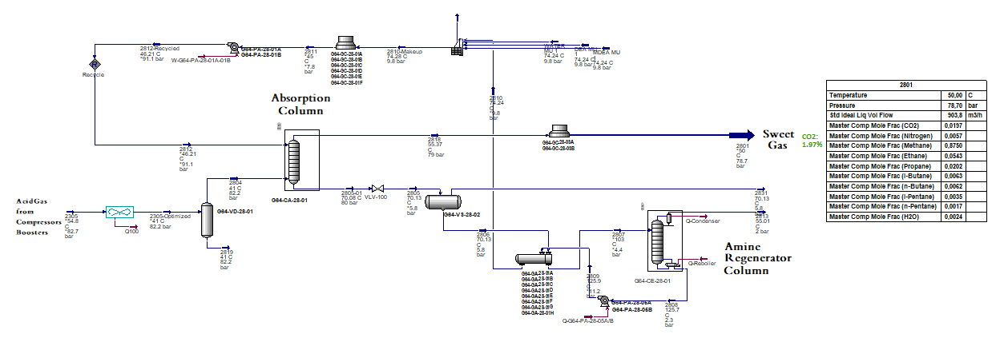
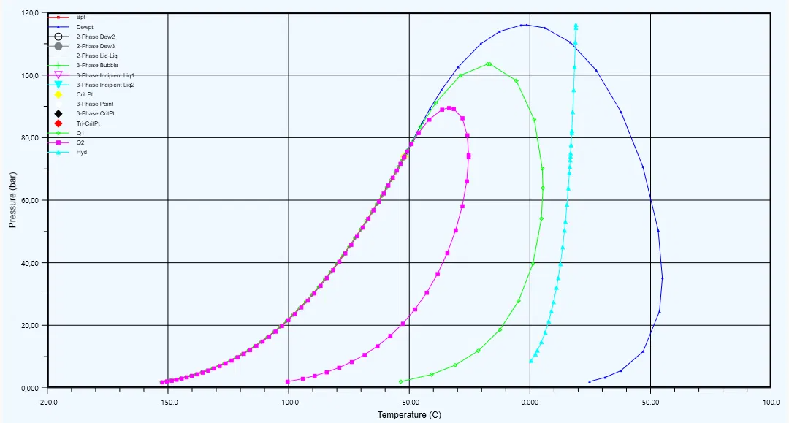

[English](README.md) | [Deutsch](README.de.md) | [Français](README.fr.md)

# Simulation et optimisation de l'unité de décarbonatation aux amines (Unité 28) dans une installation de traitement du gaz naturel avec Aspen HYSYS® (Rhourde-Nouss, Sud-Est de l'Algérie)

## Aperçu
Un modèle numérique complet basé sur HYSYS® a été développé pour l'unité de décarbonatation (AGRU) de Rhourde-Nouss (Sud-Est de l'Algérie), située dans une installation centrale de traitement (Central Processing Facility) du gaz naturel, à partir de la fiche technique propre à l'unité.

## Objectif
Respecter la spécification de 2 % mol de CO₂ dans le gaz commercial à l'installation centrale de traitement de Rhourde Nouss (Sud-Est de l'Algérie), en optimisant les températures de l'amine pauvre et du gaz brut de l'unité de décarbonatation (AGRU) à base d'amines.

## Schéma de procédé

  
   
  <em>Figure 1 : Schéma de procédé résolu et optimisé de l'unité de décarbonatation de Rhourde-Nouss.</em>

## Approche
- Construction et convergence d'un schéma de procédé complet d'unité de décarbonatation (AGRU) à base d'amines dans Aspen HYSYS®.
- Calibration des efficacités de plateaux pour le CO₂ afin que l'absorbeur reproduise les performances des absorbeurs industriels de gaz acide fonctionnant avec des mélanges DEA/MDEA.
- Évaluation de l'effet de quatre variables opératoires : température de l'amine pauvre, température du gaz d'alimentation, débit de circulation de l'amine et charge thermique du régénérateur.

## Contrôles de sécurité
- Utilisation de l'enveloppe de phases et de l'analyse des hydrates pour définir des limites de température sûres pour l'amine pauvre et le gaz d'alimentation.
- Vérification des marges de condensation et de formation d'hydrates pour les conditions opératoires retenues.

  
   
  <em>Figure 2 : Analyse de l'enveloppe de phases et des hydrates pour le courant 2305 (provenant de l'unité des compresseurs booster).</em>

## Résultat clé
| Paramètre | Cas de base | Optimisé | Spécification |
|---|---|---|---|
| CO₂ dans le gaz doux | 3,7 % mol | 1,97 % mol | < 2 % mol |

## Remarques
Les données d'entrée ont été assainies ; aucune donnée confidentielle d'usine ou de fournisseur n'est incluse.

*Ce dépôt n'est qu'un aperçu de quelques résultats obtenus avec HYSYS® (aucun fichier de simulation n'est joint).*
