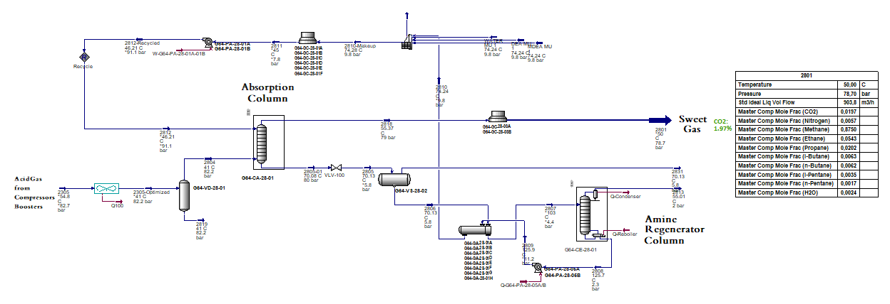

# Acid Gas Removal Unit (Amine-Based CO₂ Removal Unit (Unit 28)) Simulation and Optimization in a Natural Gas Processing Facility on Aspen HYSYS® (Rhourde-Nouss, Southeastern of Algeria)

## Overview
A complete HYSYS®-based numerical model was developed for the Acid Gas Removal Unit of Rhourde-Nouss's (Southeastern Algeria) in a Central Processing Facility for Natural Gas treatment using unit's specific datasheet.

## Objective
Meet the 2 mol% CO₂ sales gas specification at the Rhourde Nouss Central Processing Facility (southeastern Algeria) by optimizing the lean amine and raw gas temperatures of the amine-based Acid Gas Removal Unit (AGRU).

## Flowsheet

  

## Approach
- Built and converged a full amine-based AGRU flowsheet in Aspen HYSYS®.
- Calibrated the CO₂ tray efficiencies so the absorber matches industrial sour gas absorber performance with DEA/MDEA blends.
- Evaluated the effect of four operating variables: lean amine temperature, feed gas temperature, amine circulation rate and regenerator duty.

## Safety Checks
- Used phase envelope and hydrate analysis to define safe lean amine and feed gas temperature limits.
- Checked condensation and hydrate margins for the selected operating conditions.

## Key Result
| Parameter | Base case | Optimized | Specification |
|---|---|---|---|
| CO₂ in sweet gas | 3.7 mol% | 1.93 mol% | < 2 mol% |

## Notes
Inputs are sanitized or normalized; no confidential plant or vendor data is included.
*This repository is only a preview of some results developed under HYSYS® (No Simulation file is attached)*
